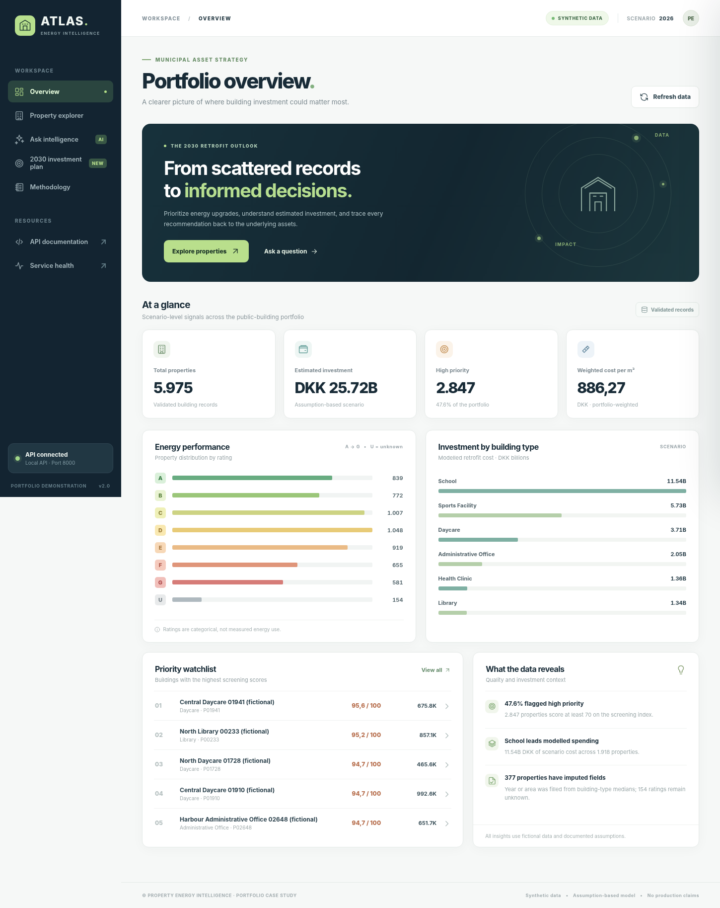
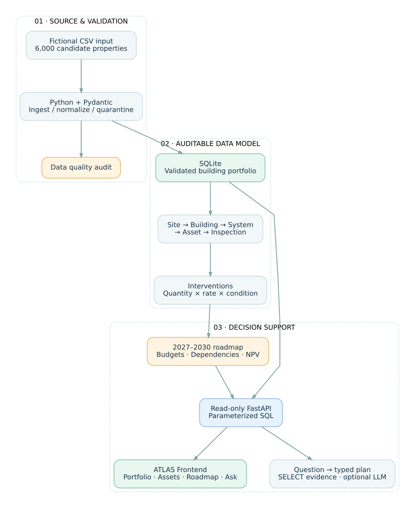
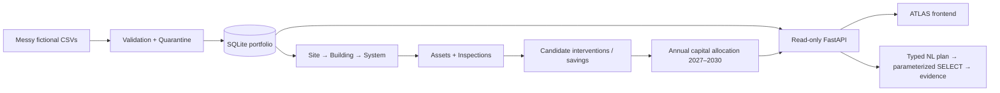

**🎥 2-minute Loom walkthrough:** `PASTE_YOUR_LOOM_SHARE_URL_HERE` *(record after publishing; see [recording script](docs/demo_script.md))*

# Property Energy Intelligence

**From fragmented facility data to an explainable 2030 retrofit shortlist.**

An interactive, API-backed data-engineering and decision-support portfolio case for municipal property managers. It ingests a deliberately imperfect portfolio, validates and models building components, estimates **scenario retrofit budgets in DKK**, exposes read-only analytics in **FastAPI**, and translates supported plain-English questions into **auditable parameterized SQL**.

> **Launch the dashboard at [http://localhost:8000](http://localhost:8000)** after starting Docker. The interface supports portfolio analytics, property filtering, component detail panels and evidence-backed questions without writing JSON by hand.



**New in v3:** asset-level inventory and transparent quantity-based cost calculations, site/system/inspection lineage, an interactive 2027–2030 investment roadmap, missing-assessment visibility, and expanded natural-language queries. [View roadmap screenshot](docs/roadmap-preview.png) · [Asset detail screenshot](docs/assets-preview.png) · [Read the full asset model](docs/asset-model.md).

**Data ethics:** All 6,000 generated buildings are *fictional*. The 2026 unit rates, estimated costs and priority scores are illustrative assumptions, **not actual government data, contractor quotations, verified predictions or evidence of meeting 2030 regulations**. No ML model was trained on historical costs.



[Editable Mermaid source](docs/architecture.mmd) · [PNG diagram](docs/architecture.png) · [Assumptions and limitations](docs/assumptions.md)

## The scenario

**Problem:** City facility managers lack unified visibility into which public buildings require urgent HVAC and insulation upgrades before 2030. Building specifications, condition assessments, and budget decisions often live in different systems.

**User stories**

- *As a financial controller, I want estimated retrofit costs per square meter so I can compare portfolios and explain budget assumptions.*
- *As a building engineer, I want to ask which buildings need attention, using natural language, and inspect the components behind each ranking.*

**Decision output:** A traceable shortlist of energy-inefficient buildings, estimated component investment, an urgency score, and an uncertainty trail for missing data. This is a **screening tool**, not an engineering specification.

## Run in one command

**Prerequisite:** Docker with Docker Compose.

```bash
docker compose up --build
```

Then open the **[interactive dashboard](http://localhost:8000)**. Use **[Swagger UI](http://localhost:8000/docs)** if you want to test the raw endpoints. On startup, the service generates source CSVs, cleans and loads the database, and publishes a data-quality audit under `data/reports/`. Docker stores the SQLite database in a **named Docker volume** to avoid Windows bind-mount file-locking and replacement issues; the project-folder `data/raw/` and `data/reports/` remain accessible.

### Windows / Docker Desktop troubleshooting

The application uses two storage locations: `./data:/app/data` for **CSV files and audit reports** and the Docker named volume `property_energy_db:/app/state` for the **SQLite database**. SQLite must not be stored on the Windows bind mount in this Docker setup. The `Dockerfile` sets `DB_PATH=/app/state/property_energy.sqlite3`.

If an older version fails with `sqlite3.OperationalError: unable to open database file`, stop its container, replace the project with this version, then run:

```powershell
docker compose down
docker compose up --build
```

Run these commands **from the folder containing the updated `docker-compose.yml`**. `docker compose down` leaves named volumes intact. If you want to **discard and regenerate the fictional database only**, `docker compose down -v` deletes Compose-managed volumes and their contents; do this only when you are happy to discard saved data. You can inspect the mounted location with `docker compose exec intelligence-api ls -lah /app/state` after startup.

A local Python alternative (Python 3.11+):

```bash
python -m pip install -r requirements.txt
python ingest.py --generate
uvicorn main:app --reload
```

The default natural-language planner is **offline and free**. It has deliberately limited but testable supported intents. For optional external LLM interpretation, see [the LLM section](#optional-llm-interpretation).

## Interactive dashboard

The frontend lives in [`frontend/`](frontend/) and is served by FastAPI at **`GET /`** using same-origin static assets. It uses plain JavaScript, HTML and CSS, so it needs **no npm installation, second web server, additional Docker service, CDN, API key or cross-origin configuration**. Docker's existing port `8000` serves both dashboard and API.

- **Overview:** Live totals, actual grade distribution, investment by building type, prioritized watchlist and data-quality notes.
- **Property explorer:** Server-side search by name/ID, type/district/energy/priority filters, sorting and pagination. Click a building to inspect component condition, systems, individual assets, inspection findings, cost quantities, modelled interventions, missing assessments and imputation flags.
- **2030 investment roadmap:** Interactive annual DKK budget, urgency/energy/NPV allocation choices, funded-year schedule, prerequisites and outstanding backlog. The approach is explicitly greedy, not an optimized capital program.
- **Ask intelligence:** Execute supported English questions through `/ask`; inspect returned rows, validated plan, bound parameters and executed SQL. The default query planner is rules-based, with a separately configurable optional LLM.
- **Methodology:** Clear warnings about fictional data, heuristic prioritization and assumption-based cost models.

Screenshots are illustrative captures using the app and deterministic dataset. See [frontend guide](docs/frontend.md).

## Live API surface

| Endpoint | Business outcome | Example |
|---|---|---|
| `GET /` | Responsive, interactive portfolio dashboard | Open in a browser |
| `GET /analytics/summary` | Portfolio totals, approximate energy grade, scenario budget, cost/m², priorities | `GET /analytics/summary` |
| `GET /analytics/breakdown` | Distribution by rating, asset type, district, components and priority | `GET /analytics/breakdown` |
| `GET /properties` | Search, filter, sort and paginate properties | `GET /properties?building_type=School&priority=high` |
| `GET /properties/{property_id}` | Drill into building and component-level cost and condition | `GET /properties/P00001` |
| `GET /properties/{property_id}/assets` | Site, systems, assets, inspections, proposed interventions, energy assumptions, coverage states | `GET /properties/P00001/assets` |
| `GET /analytics/assets` | Asset counts and intervention investment / kWh by system, coverage gaps | `GET /analytics/assets` |
| `GET /planning/roadmap` | Constrained 2027–2030 budget scenario, strategy comparison, dependencies and backlog | `GET /planning/roadmap?annual_budget_dkk=50000000&strategy=energy` |
| `POST /ask` | Natural-language intent → validated plan → parameterized SQL → evidence | See below |
| `GET /health` | Demo dataset readiness | `GET /health` |

**Ask which older schools have the worst ratings:**

```bash
curl -X POST http://localhost:8000/ask \
  -H "Content-Type: application/json" \
  -d '{"question":"Which schools built before 1970 have the worst energy ratings?"}'
```

A shortened real example from the deterministic seed:

```json
{
  "planner": "rules",
  "interpreted_plan": {
    "intent": "worst_energy",
    "building_type": "School",
    "built_before": 1970,
    "limit": 10
  },
  "verified_answer": "10 records returned (up to 10); worst displayed grade G. Excludes unknown ratings.",
  "sql_parameters": ["School", 1970, 10],
  "row_count": 10,
  "rows": [{"id":"P00060", "building_type":"School", "built_year":1911, "energy_rating":"G", "priority_score":100.0}]
}
```

The actual response contains **all returned rows and the full SQL SELECT**. The excerpt above shows only one representative row. [See the complete example response](docs/example_ask_response.json).

**Windows PowerShell example:**

```powershell
Invoke-RestMethod -Method Post -Uri 'http://localhost:8000/ask' `
  -ContentType 'application/json' `
  -Body '{"question":"Which schools built before 1970 have the worst energy ratings?"}'
```

Other supported questions:

```text
What is the cost per m2 for libraries?
What is the total retrofit cost for schools?
Show top 5 urgent HVAC upgrades in North
Which buildings have the highest maintenance priorities?
```

**Example summary with seed 42** (after validation): **5,975 properties**, **23,811 validated source components**, **2,006 fictional sites**, **53,572 derived assets**, **37,508 proposed interventions**, approximate energy grade **D** (mean ordinal score 3.81), and **DKK 886.27/m²** estimated portfolio-weighted scenario cost (about **DKK 25.72 billion**). Those numbers are fictional and reproducible, not real policy estimates.

## Architecture and design decisions




The source-of-truth architecture is also stored as a [Mermaid file](docs/architecture.mmd), alongside an [editable Graphviz source](docs/architecture.dot) and rendered image exports. The diagram shows the enriched assets and planning engine alongside the read-only API. The optional model generates a typed query plan, **never executable SQL**.

| Layer | Demonstrated skill | Implementation |
|---|---|---|
| Architecture | Requirements → traceable data flow | [Diagram](docs/architecture.svg), [decisions](docs/decisions.md) |
| Data engineering | Reproducible ETL, validation, NULL handling, referential integrity | [`ingest.py`](ingest.py), [`ingestion.py`](property_intelligence/ingestion.py) |
| Analytics & modeling | Quantity/unit based asset estimates, energy saving assumptions, NPV and priority | [`assets.py`](property_intelligence/assets.py), [`planning.py`](property_intelligence/planning.py), SQLite SQL |
| Backend | Pydantic contracts, FastAPI, HTTP error codes, Swagger | [`api.py`](property_intelligence/api.py) |
| Frontend | Responsive visualization, accessible filtering, asset detail, AI evidence | [`index.html`](frontend/index.html), [`app.js`](frontend/app.js), [`styles.css`](frontend/styles.css) |
| AI integration | Natural-language intents, optional LLM, SQL allowlist, evidence | [`query.py`](property_intelligence/query.py) |
| Delivery | Docker, CI tests, local-first operation | [`docker-compose.yml`](docker-compose.yml), [workflow](.github/workflows/tests.yml) |

## Data pipeline and audit

The generator creates **6,000 fictional buildings plus four component observations per building** with a fixed seed. It deliberately injects missing fields, inconsistent rating case, mixed date formats, duplicates and malformed rows. Ingestion:

1. Parses CSV and standardizes dates to ISO 8601, types, case and ratings.
2. Imputes truly missing year/area with the median for that building type, while retaining explicit `year_imputed` / `area_imputed` flags. Unknown energy rating is `U`, *not* silently graded.
3. Validates cleaned records with Pydantic; quarantines duplicates, invalid values and orphaned components with a reason.
4. Enriches validated source components with fictional sites, systems, individual assets, inspections, intervention candidates and explicit assessment-coverage states.
5. Computes quantity- and asset-rate-based scenario costs, rating-proxy energy baselines, illustrative annual savings, NPV, and reconciled building/portfolio totals.
6. Builds a new SQLite database with foreign keys and indexes, validates its integrity and **atomically replaces** the previous database only after a successful load.
7. Writes `data/reports/ingestion_report.json` plus rejected-source CSVs for inspection.

See [data dictionary](docs/data_dictionary.md), [asset and investment methodology](docs/asset-model.md), [cost assumptions](docs/assumptions.md) and [technical decisions](docs/decisions.md). To test at a smaller scale:

```bash
python ingest.py --generate --count 100 --seed 42
```

To ingest your own datasets, supply CSVs using the [documented column schema](docs/data_dictionary.md) instead of generating sources:

```bash
python ingest.py --properties path/to/properties.csv --components path/to/components.csv
```

## How natural-language querying stays safe

- **Default:** A transparent rule-based template parser understands a small, documented set of question types. This is *not* presented as a general LLM.
- **Optional LLM:** A model converts a question to a strictly validated Pydantic `QueryPlan` (intent and bounded filters). It does **not** author or execute SQL.
- **SQL security:** Python constructs a predefined `SELECT` statement with bound query parameters. The SQLite connection uses read-only URI mode plus `PRAGMA query_only = ON`. Unknown questions receive HTTP 422 instead of an invented answer.
- **Verification:** `/ask` exposes its interpreted plan, SQL, bound parameters, exact database rows and a deterministic explanation. Numerical answers are computed from SQLite results, not invented by the model.
- **Scope:** No account authentication or rate limiting is included. This is a localhost portfolio demo, **not a production multi-tenant API**.

### Optional LLM interpretation

To opt into a real model for intent extraction, set `PLANNER_MODE=llm` and `OPENAI_API_KEY`. This sends the user's question (not the building dataset) to the provider and **may incur API charges**. `PLANNER_MODE=auto` falls back to local rules on provider errors, and identifies the fallback in the API response.

```bash
# macOS / Linux
export PLANNER_MODE=llm
export OPENAI_API_KEY="your-key"
uvicorn main:app --reload
```

```powershell
# Windows PowerShell
$env:PLANNER_MODE = 'llm'
$env:OPENAI_API_KEY = 'your-key'
uvicorn main:app --reload
```

Copy [.env.example](.env.example) if using Docker Compose and never commit `.env` or API keys. This optional hosted-model branch requires your own credentials and is **not covered by live provider tests** in CI.

## Quality checks

```bash
python -m pip install -r requirements-dev.txt
python -m pytest -q
```

The **31 automated tests** cover frontend file serving, breakdown reconciliation, property search and pagination, data normalization and quarantine, atomic ingestion failure, database integrity, cost consistency, question parsing, SQL parameterization, all API endpoints, response evidence and error handling. A GitHub Actions workflow reruns it on pushes and pull requests.

## Honest limitations and next steps

**Not yet included:** Real BBR/energy-label integrations, actual utility consumption, surveyed asset quantities, calibrated construction rates, validated energy/CO₂ savings, historical cost training labels, production auth and a formal compliance interpretation of any 2030 requirement. The score measures *relative screening urgency*, not proof a property violates regulation.

**Useful extensions for a real employer:** connect consented/public authoritative property datasets; calibrate the cost model against historical tenders; model uncertainty intervals and independent savings verification; introduce authenticated user roles; evaluate accuracy and false positives of the LLM planner; deploy with production observability.

## Demo and publishing

Follow the timed [2-minute Loom script](docs/demo_script.md). Add the actual Loom share URL to **the first line of this README** once the screen recording exists. This repository intentionally does not contain an invented video URL.

See [publish to GitHub](docs/publishing.md) for the exact `git` / `gh` commands to create the `property-energy-intelligence` repository and push this code.

**License:** MIT. Original scenario, demo code and explicitly fictional generated data.
